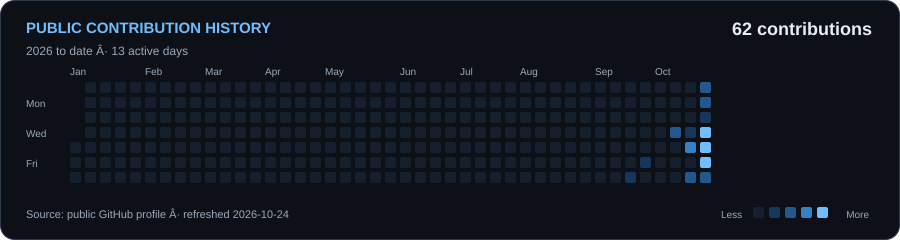
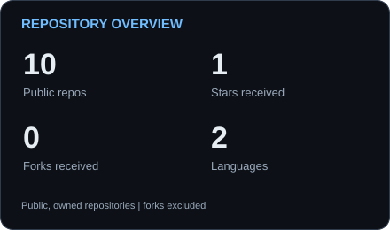
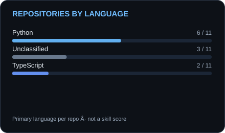

<h1 align="center">AUGEREABOVE</h1>

  <strong>Backend Engineering &middot; AI Systems &middot; Automation</strong>

  I build backend APIs, developer tools, and AI workflows. 
  My focus is repeatable execution, clear data boundaries, and software I can test.

  
  
  

## About me

I'm a Computer Science student working across backend development, AI systems, and automation.
I like turning a small working idea into something with explicit validation, useful traces, and a reproducible setup.

Right now, I'm developing my understanding of backend architecture, agent evaluation, and machine learning through practical projects.

## Selected projects

### [Agent Eval](https://github.com/AugereAbove/agent-Eval)

A tool execution runtime with an offline planner and an optional LLM planner. JSON Schema validation, worker deadlines, and an evaluation dataset make tool behavior and failures inspectable.

`Python` `JSON Schema` `pytest` `Responses API`

[Design](https://github.com/AugereAbove/agent-Eval/blob/main/docs/design.md) &middot; [Evaluation guide](https://github.com/AugereAbove/agent-Eval/blob/main/docs/evaluation.md) &middot; [CI](https://github.com/AugereAbove/agent-Eval/actions/workflows/test.yml)

### [Multisite Content API](https://github.com/AugereAbove/multisite-content-api)

A Django REST API for content across multiple sites. Site-scoped queries, draft visibility, and staff write permissions are backed by database constraints and API tests.

`Python` `Django REST Framework` `SQLite` `Docker`

[API reference](https://github.com/AugereAbove/multisite-content-api/blob/main/docs/api.md) &middot; [Run locally](https://github.com/AugereAbove/multisite-content-api#quick-start) &middot; [CI](https://github.com/AugereAbove/multisite-content-api/actions/workflows/test.yml)

### [AI Browser Agent](https://github.com/AugereAbove/AI-browser-agent)

A bounded browser automation runtime with an independently verified storefront workflow and SQLite run history. The working demo uses deterministic tasks; LLM planning remains planned.

`TypeScript` `Node.js` `Playwright` `Zod` `Vitest`

[Run the demo](https://github.com/AugereAbove/AI-browser-agent#verified-fixture-task) &middot; [Read sessions](https://github.com/AugereAbove/AI-browser-agent#read-sessions) &middot; [Run history](https://github.com/AugereAbove/AI-browser-agent#saved-runs)

### [AdaptiveEdge](https://github.com/AugereAbove/adaptive-Edge) &middot; Experimental

A library for language model benchmarking and constrained model selection. It records observations in SQLite and compares model configurations using quality, latency, and memory evidence.

`Python` `Pydantic` `SQLite` `Ollama`

[Library source](https://github.com/AugereAbove/adaptive-Edge/tree/main/src/adaptiveedge) &middot; [Benchmark runner](https://github.com/AugereAbove/adaptive-Edge/blob/main/src/adaptiveedge/benchmarks/runner.py)

## Technology toolbox

<strong>Programming languages</strong>

  
  
  
  
  
  
  

<strong>Web &amp; data</strong>

  
  

SQL

<strong>Backend</strong>

  
  
  

<strong>Development &amp; infrastructure</strong>

  
  
  

<strong>Testing &amp; validation</strong>

  
  
  

Pydantic &middot; JSON Schema

The programming languages listed reflect my knowledge; my public portfolio primarily demonstrates Python and TypeScript. Frameworks and tools are used in my public projects, including FastAPI in <a href="https://github.com/AugereAbove/Vibrato">Vibrato</a>.

## GitHub activity

  <picture>
    <source media="(max-width: 600px)" srcset="./assets/activity/activity-mobile.svg">
    
  </picture>

  
  

Real public account data, refreshed daily. <a href="./docs/activity.md">Metric scope, sources, and attribution</a> &middot; <a href="https://github.com/AugereAbove/AugereAbove/actions/workflows/profile-summary-cards.yml">Refresh workflow</a>

## Connect

I'm open to backend and software engineering opportunities, including remote roles, and collaborations on developer tools, automation, and AI systems.

  <a href="https://github.com/AugereAbove?tab=repositories">Explore my work</a>
  &nbsp;&middot;&nbsp;
  <a href="https://github.com/AugereAbove/agent-Eval/issues">Discuss a project</a>

